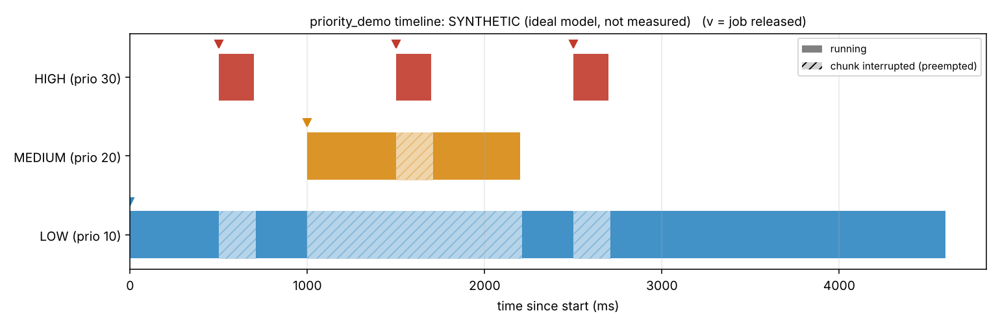

# QNX-Based Real-Time Scheduling for Drone Flight Controllers

A small C project that models how a **drone flight controller (FC)** schedules real-time tasks on the **QNX Neutrino RTOS**: priority-based preemption, blocking and resumption, with timestamped execution logs and a Python analyzer that draws a scheduling timeline and compares measured response times against an ideal flight-controller workload model.

> **Status:** Phase 1 (three-task flight-controller scheduling model + logging + analyzer).  
> The C code compiles cleanly with `gcc` on Linux (syntax check) and the analyzer has been exercised on a Linux test run and on synthetic data.  
> **It has not yet been built with `qcc` or run on a QNX VM.** No QNX results are claimed anywhere in this repo until that happens.

## What it demonstrates

Three representative drone flight-controller tasks share **one CPU** (pinned) under `SCHED_FIFO`:

| Task | Priority* | Released at | CPU work |
|---|---|---|---|
| HIGH (flight stabilization/control loop) | 30 | 500, 1500, 2500 ms | 200 ms per job |
| MEDIUM (navigation/state processing) | 20 | 1000 ms | 1000 ms |
| LOW (telemetry/background processing) | 10 | 0 ms | 3000 ms |

\*Placeholder priorities; the program prints the valid `SCHED_FIFO` range at startup and refuses out-of-range values. These are representative task roles, not implemented flight-control algorithms.

A higher-priority task can only preempt when it is **ready**, so each thread blocks on an absolute-time sleep until its release time. Work is counted in calibrated CPU iterations, not wall-clock time, so a preempted task genuinely takes longer to finish.

### Behaviour

Single CPU, zero switch cost. Produced by `analyzer/rtmodel.py`:

| Task | Job | Expected response |
|---|---|---|
| HIGH | 0, 1, 2 | 200 ms each (never delayed) |
| MEDIUM | 0 | 1200 ms (1000 work + 200 preempted by HIGH job 1) |
| LOW | 0 | 4600 ms (3000 work + 600 for HIGH's three jobs + 1000 for MEDIUM) |



*Synthetic: this is the model's prediction, not a measurement. Hatched = chunk interrupted by a higher-priority task.*

## Architecture

```mermaid
flowchart LR
  subgraph Host["Windows host"]
    B["Momentics / qcc build"]
    A["Python timing analyzer"]
  end
  subgraph VM["QNX Neutrino VM (VMware)"]
    subgraph P["Drone FC workload simulation"]
      H["HIGH: Stabilization/control"]
      M["MEDIUM: Navigation/state processing"]
      L["LOW: Telemetry/background"]
    end
    K["QNX kernel scheduler"]
  end
  B -->|deploy binary| P
  K -. schedules .-> P
  P -->|CSV log| A


