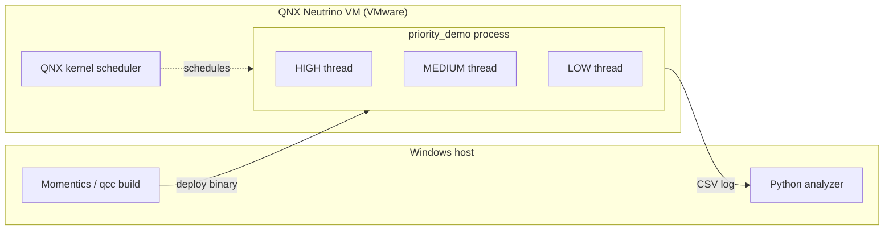

# QNX Priority-Based Scheduling Demo

A small C project that shows how the **QNX Neutrino RTOS** schedules POSIX threads of different priorities: preemption, blocking, resumption, with timestamped logs and a Python analyzer that draws a timeline and compares measured response times against an ideal model.

> **Status:** Phase 1 (three-thread scheduling demo + logging + analyzer).
> The C code compiles cleanly with `gcc` on Linux (syntax check) and the analyzer has been exercised on a Linux test run and on synthetic data.
> **It has not yet been built with `qcc` or run on a QNX VM.** No QNX results are claimed anywhere in this repo until that happens.

## What it demonstrates

Three threads share **one CPU** (pinned) under `SCHED_FIFO`:

| Thread | Priority* | Released at | CPU work |
|---|---|---|---|
| HIGH | 30 | 500, 1500, 2500 ms | 200 ms per job |
| MEDIUM | 20 | 1000 ms | 1000 ms |
| LOW | 10 | 0 ms | 3000 ms |

\*Placeholders; the program prints the valid `SCHED_FIFO` range at startup and refuses out-of-range values.

A higher-priority thread can only preempt when it is **ready**, so each thread blocks on an absolute-time sleep until its release time. Work is counted in calibrated CPU iterations, not wall-clock time, so a preempted thread genuinely takes longer to finish.

### Behaviour

Single CPU, zero switch cost. Produced by `analyzer/rtmodel.py`:

| Task | Job | Expected response |
|---|---|---|
| HIGH | 0, 1, 2 | 200 ms each (never delayed) |
| MEDIUM | 0 | 1200 ms (1000 work + 200 preempted by HIGH job 1) |
| LOW | 0 | 4600 ms (3000 work + 600 for HIGH's three jobs + 1000 for MEDIUM) |


*Synthetic: this is the model's prediction, not a measurement. Hatched = chunk interrupted by a higher-priority thread.*


## Architecture



The application does **not** implement a scheduler; it observes the one in the QNX kernel.

## Repository layout

```
src/            priority_demo.c (threads, config)  evlog.c (event log)  timeutil.c (clock, spin)
include/        evlog.h  timeutil.h
analyzer/       analyze.py (stats + timeline)  rtmodel.py (ideal schedule)  make_synthetic.py
examples/       synthetic sample CSV + timeline (clearly labelled synthetic)
logs/           your measured logs (git-ignored)
docs/           setup notes
Makefile        qcc build for QNX x86_64; `make host` for a Linux syntax check
```


